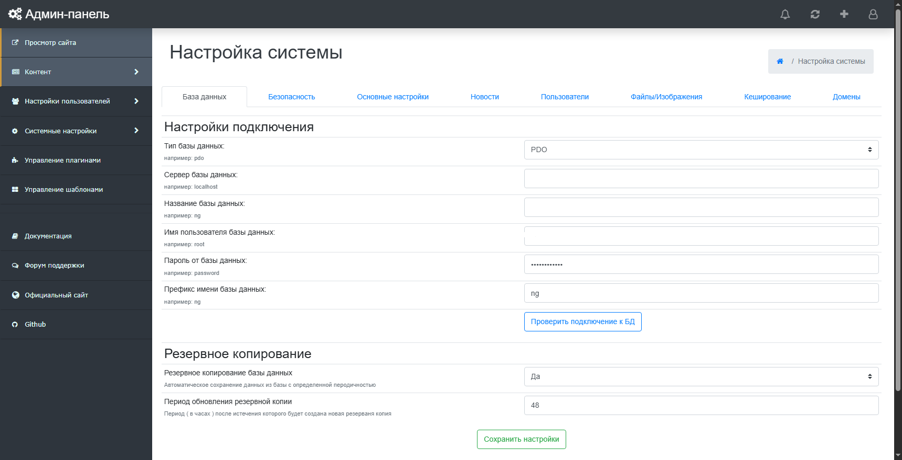

# Настройки системы
Все основные настройки CMS и вашего сайта сосредоточены в разделе "Настройки системы".
Все настройки поделены на вкладки, в зависимости от их предназначения.
У каждой опции существует своё описание, которое поможет вам при внесении изменений. (рис 8.1).

рис 8.1

Для SQLite вкладка базы данных показывает текущий путь к файлу и префикс таблиц,
скрывая параметры подключения MySQL. Путь доступен только для просмотра: перенос
базы через эту форму не поддерживается. Автоматические резервные копии SQLite
пока не поддерживаются; если они были включены ранее, их можно отключить.

В настройке формата разметки текста можно выбрать BBCode, Markdown или отключить обработку. Формат применяется глобально: при выборе Markdown в редакторах показывается панель Markdown-инструментов, при выборе BBCode — панель BBCode. Смена режима меняет отображение уже сохранённого текста, но не преобразует его содержимое.

© 2008-2025 Next Generation CMS
