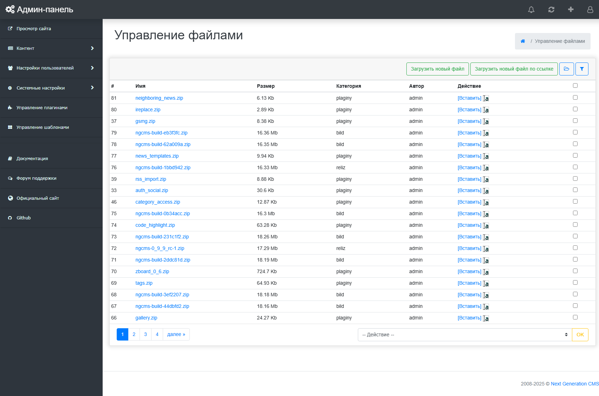
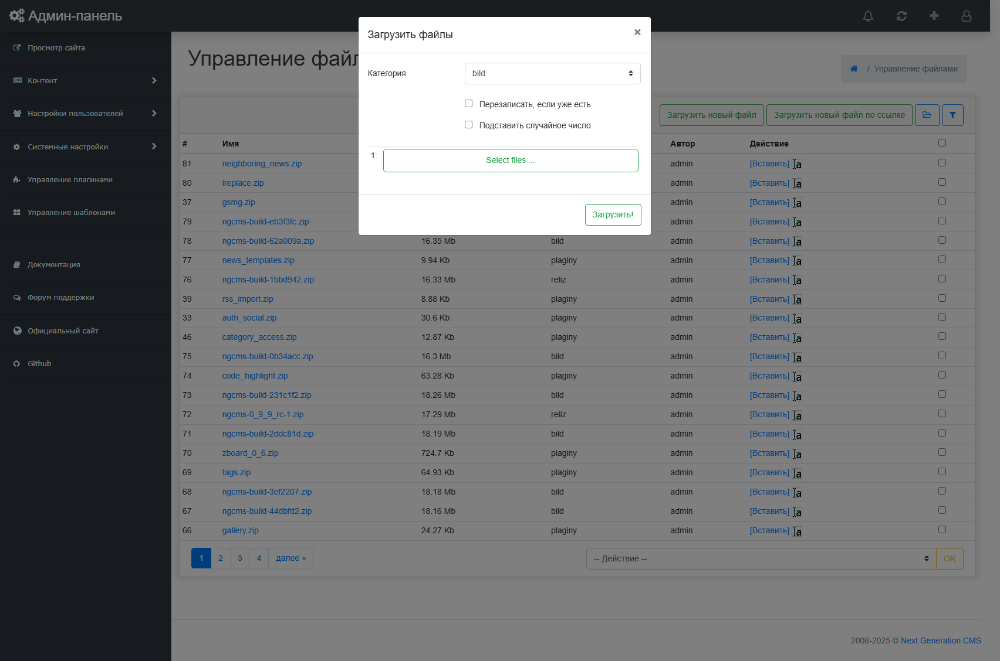
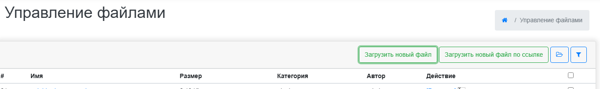

# Управление файлами
Next Generation CMS позволяет выполнять различные операции над файлами, а также создавать хранилища файлов сложной структуры. (рис 13.1).

рис 13.1
# Работа с категориями файлов
Компонент позволяет создавать неограниченное количество категорий одинарной вложенности. (рис 13.2).
Для создания категории, нужно выбрать вкладку "Категории", ввести в поле вваода "Имя" название новой категории и нажать кнопку "Ок".
В этой же вкладке осуществляется удаление категорий.

рис 13.2
Для удаления категории, сначала удалите все файлы, которые назодятся в данной категории.
# Загрузка файлов
Чтобы попасть в раздел загрузки файлов, выбирите вкладку "Загрузить файлы".
Предусмотренно 2 различных варианта загрузки файлов - с компьютера и по ссылке. (рис 13.3).

рис 13.3
© 2008-2025 Next Generation CMS

## Приватные вложения платных новостей

Если активен Finance, новые файлы, загруженные через поле вложений штатного редактора новости с положительной ценой, сохраняются вне публичного каталога сайта. Их выдача выполняется через Finance после входа пользователя и проверки доступа; лимит скачиваний настраивается в Finance. Старые вложения и файлы из общего менеджера остаются в обычном публичном хранилище. Подробности и требования к правам каталога см. в [документации Finance](../engine/plugins/finance/plugin.md).
