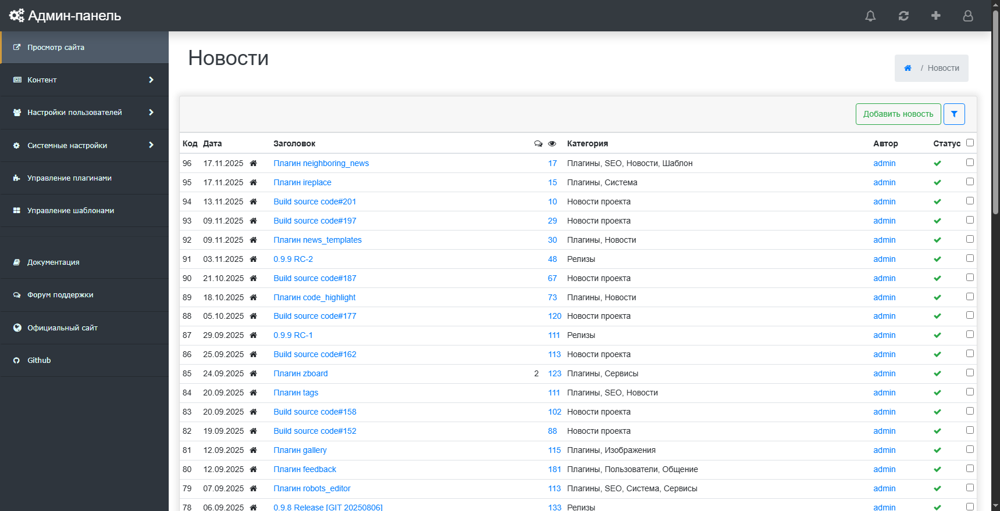
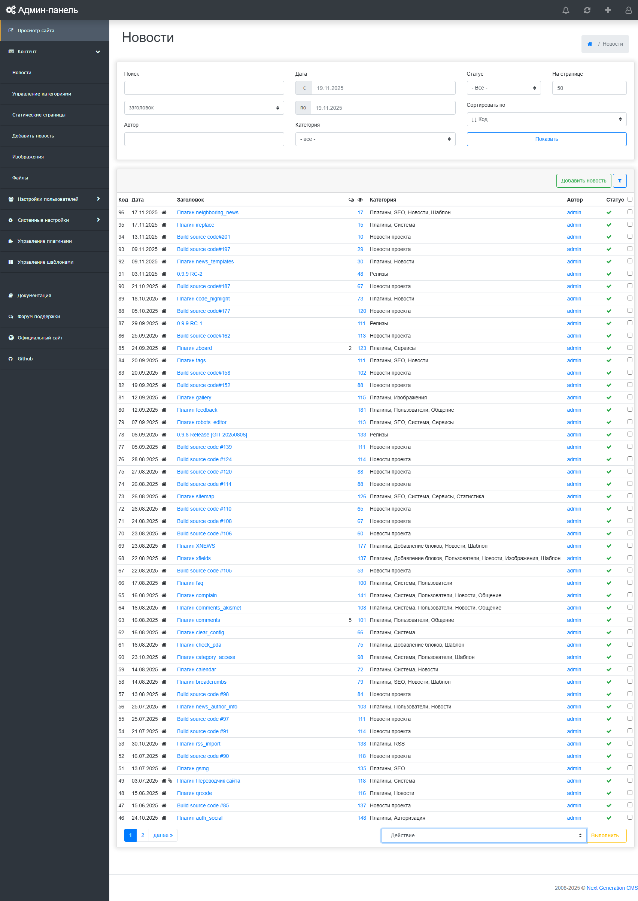
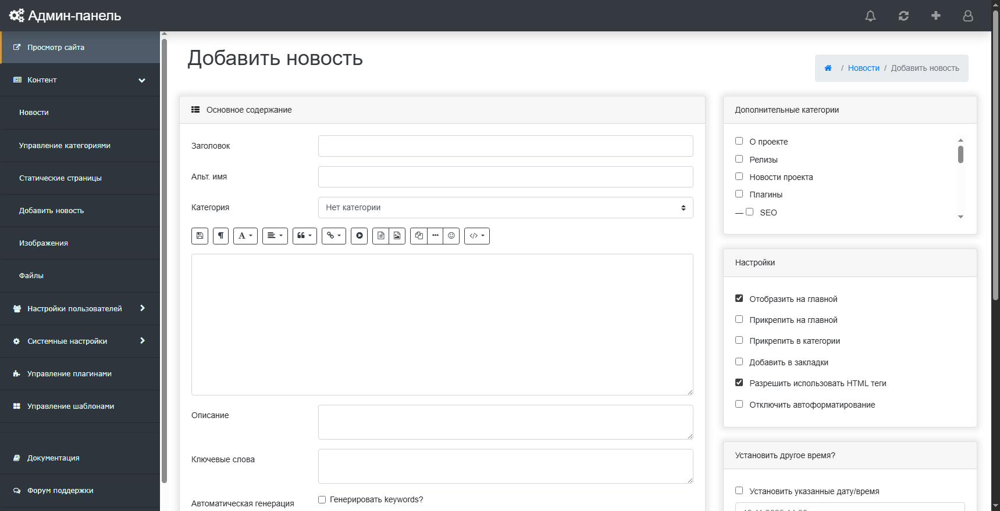
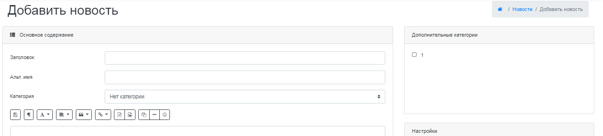
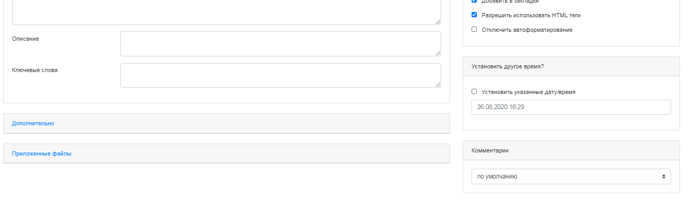
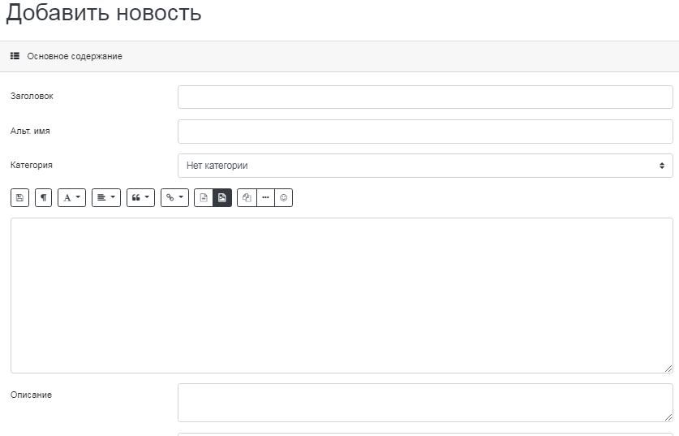
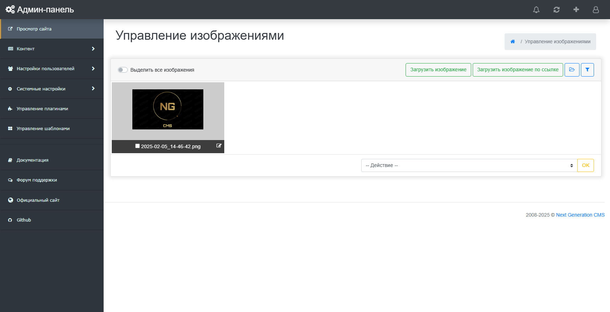
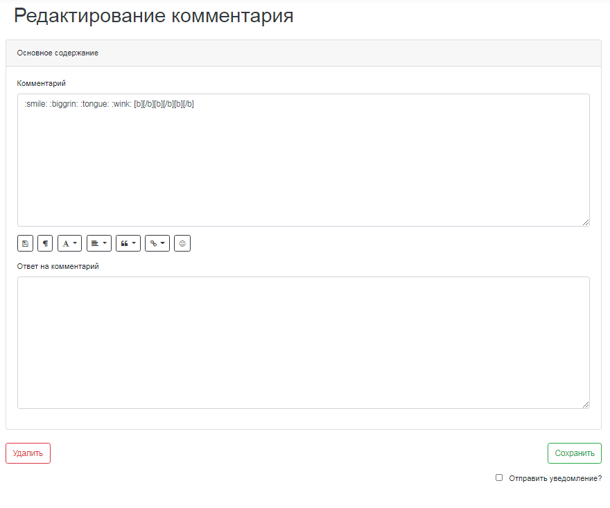
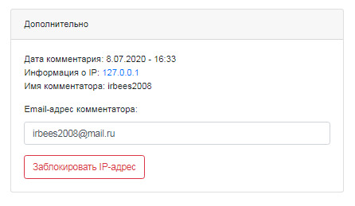

# Работа с новостями
Данный компонент позволяет организовать и вести ленту новостей по типу онлайн-СМИ.
Множество настроек визуализации и листинга, возможность подключить комментарии пользователей и систему оценок материалов пользователями.
Применяется как на новостных проектах, так и на корпоративных, например, для освещения событий на рынке. Поддержка тегов (меток).
Компонент предусматривает возможность поиска по новостям и их сортировку по различным критериям. (рис 3.1).

рис 3.1
Для удобства были созданы инструменты массового управления новостями. (рис 3.2).

рис 3.2
Для ускорения списков новостей используются индексы `idx_news_approved_order`, `idx_news_home_order`, `idx_news_approved_pinned_order` и `news_id_pagination (id)` на таблице новостей, а также `idx_news_category (newsID, categoryID)` и `newsmap_category_news (categoryID, newsID)` на карте категорий. При обновлении схемы движка они создаются автоматически. Для главной страницы с сортировкой по закреплению и дате используется `idx_news_home_order (approve, mainpage, pinned, postdate)`, а для общего списка опубликованных новостей — `idx_news_approved_pinned_order (approve, pinned, postdate, id)`.
Обычная выборка новостей сначала сортирует и ограничивает по странице только список ID, затем загружает полные строки только для найденной страницы. На главной странице с сортировкой по закреплению и дате также сначала выбирается страница ID по индексу `idx_news_home_order`, затем загружаются только нужные полные записи. Это снижает стоимость глубокой пагинации и предотвращает чтение широких строк таблицы для всех пропускаемых записей.
В списке новостей админ-панели страница сначала выбирается по ID, и только затем загружаются полные строки выбранных новостей. В MySQL для пагинации по ID используется компактный индекс `news_id_pagination`. При переходе в категорию без дополнительных фильтров опубликованные ID выбираются в порядке `newsID` из `newsmap_category_news`, а черновики — отдельно по `catid`; каждая ветка ограничена числом кандидатов, нужным для текущей страницы, перед объединением. При дополнительных фильтрах принадлежность опубликованных новостей проверяется через `idx_news_category`. Подсчёт опубликованных записей выполняется по индексу карты, а черновиков — по индексу `idx_news_approved_order`; сортировка для подсчёта не используется. В SQLite подсказки индексов не применяются, а категория проверяется при выборе страницы; черновики ищутся по отдельным ID в списке `catid`.
В публичном списке категории опубликованные новости для обычных страниц выбираются начиная с `newsmap_category_news (categoryID, newsID)`, затем сортируются по закреплению и дате, и только после ограничения страницы загружаются полные строки. Для глубокой пагинации (смещение от 10 000 записей) движок сканирует `idx_news_approved_order` в нужном порядке и проверяет принадлежность категории через `idx_news_category`; это позволяет избежать сортировки всей выборки категории.
При удалении новости счётчики уменьшаются только для уникальных положительных ID категорий; пустые и некорректные элементы `catid` игнорируются. Связанные с новостью файлы и изображения удаляются вместе с записями вложений и миниатюрами. Движок не сканирует тексты других новостей для поиска ручных ссылок на эти файлы; если файл вручную использован в другой новости, такая ссылка перестанет работать после удаления исходной новости.
Плагин Xnews фильтрует новости по категориям через индексированную таблицу связей `news_map`, а не поиском регулярного выражения по строковому полю `catid`. Список новостей для нескольких категорий строится через уникальные ID из `news_map`, чтобы избежать повторов. Сначала фильтруются, сортируются и ограничиваются ID на нужной странице, и только затем загружаются полные строки новостей. Для сортировки по дате с ограничением категории новости перебираются по индексу `postdate`, а принадлежность категории проверяется индексированным подзапросом по `newsID` и `categoryID`. Так база может остановить перебор после нахождения нужного количества новостей, не материализуя и не сортируя все связи большой категории. Для остальных сортировок сохраняется выборка ID из `news_map` через `newsmap_category_news` с последующей сортировкой.
# Добавление новости
Для добавления новости, нажмите на ссылку "Добавить" в верхней информационной панели (рис 3.3).

рис 3.3
После этого вы будете перенаплавлены на страницу с формой, которую вам потребуется заполнить.
**Внимание:** в новости поля Заголовок и Текст новости являются обязательными для заполнения!.
**Заголовок** - указывается название новой страницы. Полный текст заголовка передаётся в тег `<title>` страницы и отображается в заголовке окна браузера; поисковая система может самостоятельно сократить его в результатах поиска.
При выходе из поля заголовка форма автоматически ищет совпадения с начала названия и показывает до пяти найденных новостей.
**Текст** - собственно, сам текст новости.
**Альт. имя** - здесь необходимо указать ссылку на данную страницу. **Внимание:** ссылка должна указываться на латинице и не содержать спецсимволов и пробелов.
**Описание** - используется при создании краткого описания страницы, используется поисковыми системами для индексации.
**Ключевые слова** - ключевые слова для метатега keyword.
**Настройки**
- Опубликовать - в случае выбора данного флага, данная новость будет отображаться на сайте.
- Отобразить на главной - в случае выбора данного флага, данная новость не будет отображаться на главной странице сайта.
- Прикрепить - в случае выбора данного флага, данная новость будет отображаться первой на старнице.
- Добавить в закладки - в случае выбора данного флага, данная новость будет добавлена в закладки (используется плагин favorites).
- Разрешить использовать HTML теги - в случае выбора данного флага, в теле страницы, помимо bb кодов можно будет использовать html теги.
- Отключить автоформатирование - в случае выбора данного флага, будет отключено автоформатирование текста, перенос строк и прочее.
- Комментарии - используется при работе с плагином comments, возможно 3 варианта:
  запретить - комментарии будут запрещены
  разрешить - комментарии будут разрешены
  по умолчанию - флаг разрешения/запрета комментариев будет браться из настроек главной категории новости.
**Выбор категории**
При добавлении новости можно выбрать одну или несколько категорий. При просмотре, новость будет отображаться в каждой из них. (рис 3.4).

рис 3.4
**Выбор времени публикации и работа со сторонними плагинами**
При выборе вкладки "Дополнительно" отображается страница, с настройками даты и времени публикации. Также на этой странице расположены настройки сторонних плагинов, таких как tags, xfields и других.

рис 3.5
# Форматирование текста

Глобально выберите формат разметки в настройках системы: BBCode, Markdown или отключённую обработку. В каждый момент используется только выбранный формат; панель инструментов в редакторах автоматически соответствует выбранному режиму. Переключение меняет отображение уже сохранённых новостей и других текстов.

## Markdown
- `# Заголовок` ... `###### Заголовок` — заголовки уровней 1–6.
- `**жирный**`, `*курсив*`, `~~зачеркнутый~~` — выделение текста; для подчеркивания используется HTML-тег `<u>`.
- Текст в одиночных обратных кавычках — строчный код; HTML-форматтер BBCode-режима его не преобразует в блок подсветки.
- `[ссылка](https://example.com)` и `` — ссылка и изображение.
- `- пункт` или `1. пункт` — маркированный или нумерованный список.
- `> цитата` — цитата; таблицы поддерживаются Markdown Extra.
- Команды форматирования, списки, специальные блоки, ссылки/медиа, код, разрывы страниц и смайлики сгруппированы в выпадающих меню панели; уровни заголовков 1–6 находятся в отдельном меню, а таблица вставляется отдельной кнопкой.
- Три обратные кавычки до и после текста — блок кода; подсветка языка доступна через меню кода.
- Панель Markdown также содержит выравнивание, цвета и размер текста, спойлер, акроним, загрузку изображений/файлов, смайлики, медиа и доступные финансовые блоки. Загрузка вставляет Markdown-ссылки/изображения; функции CMS, для которых нет стандартного синтаксиса Markdown (например, `[hide]`, `[media]` и `[fin_lock]`), используют специальные теги движка или плагина. Отдельная команда экранирования BBCode не требуется: в режиме Markdown BBCode не обрабатывается, а для выделения буквального фрагмента можно использовать встроенный код.

## Таблицы BBCode
В режиме BBCode панель позволяет вставить таблицу с заголовками и ячейками. Используются парные теги `[table]`, `[tr]`, `[th]` и `[td]`, например:

```text
[table]
[tr][th]Заголовок 1[/th][th]Заголовок 2[/th][/tr]
[tr][td]Ячейка 1[/td][td]Ячейка 2[/td][/tr]
[/table]
```

Для заголовков BBCode используется форма `[h=1]Текст[/h=1]` с одинаковым уровнем от 1 до 6. Несовпадающие или выходящие за этот диапазон уровни не преобразуются.

## BBCode
Ниже перечислены доступные BB-коды.

Панель BBCode организована так же, как панель Markdown: форматирование, выравнивание, цвет, списки и специальные блоки, ссылки/медиа, файлы и изображения, разрывы страниц, смайлики и код доступны через отдельные выпадающие меню. Заголовки собраны в меню, таблица и абзац остаются отдельными кнопками.

В административном скине `default6` для панели BBCode используется общий шаблон `default` с адаптацией под Bootstrap 3; окна смайликов и emoji подключаются на страницах создания и редактирования новости.

- **[b]** ... **[/b]** - выделить текст жирным шрифтом (аналог HTML тега \<b\> ... \</b\>)
- **[u]** ... **[/u]** - выделить текст подчеркиванием (аналог HTML тега \<u\> ... \</u\>)
- **[i]** ... **[/i]** - выделить текст курсивом (аналог HTML тега \<i\> ... \</i\>)
- **[s]** ... **[/s]** - зачеркнуть текст (аналог HTML тега \<s\> ... \</s\>)
- **[p]** ... **[/p]** - выделить абзац (аналог HTML тега \<p\> ... \</p\>)
- **[ul]** ... **[/ul]** - тег форматирования (аналог HTML тега \<ul\> ... \</ul\>)
- **[ol]** ... **[/ol]** - тег форматирования (аналог HTML тега \<ol\> ... \</ol\>)
- **[li]** ... **[/li]** - тег форматирования (аналог HTML тега \<li\> ... \</li\>)
- **[left]** ... **[/left]** - отцентровать текст по левому краю (аналог HTML тега \<p style="text-align: left;"\> ... \</p\>)
- **[right]** ... **[/right]** - отцентровать текст по центру (аналог HTML тега \<p style="text-align: center;"\> ... \</p\>)
- **[center]** ... **[/center]** - отцентровать текст по правому краю (аналог HTML тега \<p style="text-align: right;"\> ... \</p\>)
- **[code]** ... **[/code]** - выделить программный код (аналог HTML тега \<code\> ... \</code\>)
- **[quote]** ... **[/quote]** - выделить цитату
- **[quote=ИМЯ]** ... **[/quote]** - выделить цитату указав в качестве автора цитаты - **ИМЯ**
- **[acronym]** ... **[/acronym]** - выделить акроним (аналог HTML кода \<acronym\>...\</acronym\>
- **[acronym=ОПИСАНИЕ]** ... **[/acronym]** - выделить акроним с описанием(аналог HTML кода \<acronym title="**ОПИСАНИЕ**"\>...\</acronym\>
- **[email]** **АДРЕС** **[/email]** - добавить ссылку на e-mail адрес **АДРЕС**
- **[email=АДРЕС]** **ОПИСАНИЕ** **[/email]** - добавить ссылку на e-mail адрес **АДРЕС** указав в качестве описание - **ОПИСАНИЕ**. При этом адрес может браться в двойные кавычки
- **[img=ССЫЛКА ФЛАГИ]** **ОПИСАНИЕ** **[/img]** - добавить картинку расположеную по адресу **ССЫЛКА** с описанием **ОПИСАНИЕ** установив флаги **ФЛАГИ**
  Можно использовать следующие флаги (значение флагов можно брать в кавычки), при этом наличие флагов - не обязательно:
  **width** - ширина картинки
  **height** - высота картинки
  **border** - толщина рамки вокруг картинки
  **align** - расположение картинки, может быть: left, right, center
  **class** - к какому CSS классу должна принадлежать картинка
  Пример: [img=http://htmlbook.ru/images/title.gif width=50 height="60" border=0 align=left]описание картинки[/img]
- **[img ФЛАГИ]ССЫЛКА[/img]** - по аналогии с предыдущим пунктом, но **описание** будет генерироваться автоматически, в него пропишется имя файла (без пути)
- **[url=ССЫЛКА ФЛАГИ]** **ОПИСАНИЕ** **[/url]** - добавить ссылку на ресурс, расположеный по адресу **ССЫЛКА** с описанием **ОПИСАНИЕ** установив флаги **ФЛАГИ**
  Можно использовать следующие флаги (значение флагов можно брать в кавычки), при этом наличие флагов - не обязательно:
  **target** - имя окна или фрейма куда браузер загружает данные (обычно используется окно со служебным именем **\_blank** - открыть ссылку в новом окне)
  **class** - к какому CSS классу должна принадлежать картинка
  Пример: [url=http://htmlbook.ru/ target="\_blank"]HTMLBook - документация по HTML[/url]
- **[url ФЛАГИ]ССЫЛКА[/url]** - по аналогии с предыдущим пунктом, но **описание** будет генерироваться автоматически, оно будет соответствовать ссылке
# Добавление изображения/файла к новости
Для добавления изображения к новости требуется нажать на соответствующую иконку на панели bb тегов. (рис 3.6).

рис 3.6
Откроется всплывающее окно - загрузчик изображений. (рис 3.7). Подробнее о непосредственной загрузке изображений и файлов, можно прочитать в соответствующем разделе справки.

рис 3.7
Добавить файл к новости можно двумя различными способами.
- Непосредственно
- При помощи аттачментов
# Редактирование новости
Редактирование новости имеет все теже самые настройки и опции что и добавление, за исключением вкладки "Комментарии".
В этой вкладке отображаются все комментарии, которые были добавлены к данной новости.
Инструмент позволяет быстро удалить/отредактировать их, либо заблокировать IP комментатора. (рис 3.11).

рис 3.11
Также можно посмотреть подробные сведенья о каждой комментарии отдельно. (рис 3.12).

рис 3.12
© 2008-2025 Next Generation CMS
